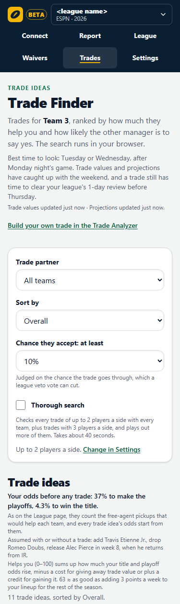
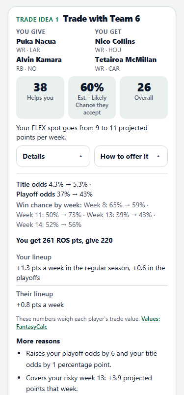
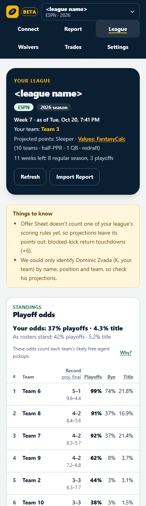
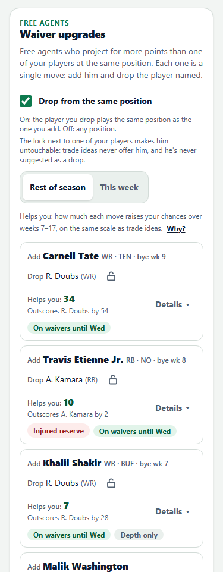

# Offer Sheet

Offer Sheet finds and ranks fantasy football trades for your team. It's free, it works with ESPN and Sleeper leagues,
and it's read-only: it never sends an offer or changes anything on your league's platform.

**Live beta: [offersheet.vercel.app](https://offersheet.vercel.app)**

<p>
  
  
  
  
</p>

<sub>Screenshots at phone width from a real league. Team names are replaced with placeholders.</sub>

## What it does

1. **Imports your league** from ESPN or Sleeper (Yahoo is waiting on Yahoo's approval; Fleaflicker, MyFantasyLeague,
   Fantrax and manual entry come later).
2. **Understands it exactly:** the scoring rules, the lineup slots, bench, IR and taxi, the playoff format and trade
   deadline, the league type and every roster. An Import Report shows what it understood.
3. **Works out needs and trade chips** for every team: where each lineup is weak, and which players are worth more to
   another team than to their own.
4. **Searches and ranks trades** with every other team. Each idea gets three numbers:
   - **Helps you** (0–100): how much the trade raises your odds of what your league rewards (the title, the
     playoffs or your league's prizes), from a simulation of the rest of the season;
   - **Chance they accept**: an estimate from a model of how managers judge offers;
   - **Overall**: the two combined, which ranks the list.
5. **Explains each idea** in plain English, suggests how to offer it (a first offer, then fallbacks), and writes a
   message you can copy to the other manager.

It also has a Trade Analyzer for any trade you build (including offers you received, and "what if" roster changes), a
League page with odds, schedule risk, trade partners and waiver upgrades, and an optional Thorough search.

## How it works

- **Server routes** (Next.js) read the league and normalize it into one `LeagueSnapshot`. Public leagues are read by
  your own browser and uploaded, so each visitor's requests count against their own IP address.
- **The engine** is pure, deterministic TypeScript (`src/engine/`) that runs in a Web Worker in your browser:
  - projections per player and week, scored with your league's own rules (Sleeper's, blended with ESPN's for ESPN
    leagues, and leaned toward the trade market);
  - an exact lineup solver, averaged over simulated injury and bye scenarios, so bench depth counts;
  - a Monte Carlo season simulation (20,000 seasons for every number a page shows, with common random numbers so a
    trade's effect isn't noise), playoffs and tiebreakers included;
  - a trade search that screens thousands of trades quickly, evaluates the best exactly and simulates the finalists;
  - a logistic acceptance model and template-based explanations (no AI calls).
- **Tech:** Next.js 16, TypeScript (strict), Tailwind, zod at every API boundary, Vitest (about 6,000 tests). Hosted
  on Vercel, with Upstash Redis as the shared cache.

## How it was built

The whole spec is in [`CLAUDE.md`](CLAUDE.md). A separate planner chat wrote it and keeps it current. Claude Code
built the app phase by phase against it, starting September 29, 2026. Each phase ended at a checkpoint: tests,
typecheck and lint passing, an adversarial review, and a report. The checkpoint reports are in
[`reports/`](reports/) (`checkpoint-*.md`), with the planner's replies (`planner-reply-*.md`) and the status
(`STATUS.md`). The `checkpoint-*` tags mark the approved versions.

## Repository tour

| Path | What's there |
|---|---|
| `src/engine/` | The math: projections, lineups, simulation, market values, acceptance, trade search, explanations. All config in `config.ts`. |
| `src/adapters/` | ESPN and Sleeper (and future platforms): fetch and normalize into a `LeagueSnapshot`. |
| `src/app/`, `src/components/` | The Next.js pages and API routes, and the React components. |
| `src/server/` | Server-side caching, rate limits, budgets, logging. |
| `src/workers/` | The Web Worker that runs the engine. |
| `scripts/` | Probes, reports, the browser check, deploy and publish scripts. |
| `fixtures/` | Sanitized API captures for the tests (sources and licenses: [`fixtures/THIRD-PARTY.md`](fixtures/THIRD-PARTY.md)). |
| `reports/` | Checkpoint reports, the planner's replies, generated reports and screenshots. |

## About this public copy

- **FantasyCalc's trade values aren't included.** Offer Sheet uses them under FantasyCalc's conditions for free use,
  which don't allow republishing them. Their captured lists are left out of every commit, values quoted in the
  reports, docs and comments read `[value]`, and the tests that need the lists skip here.
- **Leaguemates stay anonymous:** names, team names and ids are placeholders like "Team 3" throughout.
- **Commit hashes** quoted in `CLAUDE.md` and the reports refer to the private working repository. This history was
  filtered for publication, so its hashes differ.

## Running it locally (PowerShell)

```powershell
npm install
Copy-Item .env.example .env.local
npm run gen:secret
npm run dev
```

Then open http://127.0.0.1:3001/connect and connect an ESPN or Sleeper league. Fill in `.env.local` with whatever you
have; blank means "not available", and `npm run check-env` shows only "set" or "blank". The engine runs in the
browser.

| Command | What it does |
|---|---|
| `npm test` | Unit tests (no network) |
| `npm run typecheck` | TypeScript checks |
| `npm run lint` | ESLint |
| `npm run check:leaks` | Scans everything git would commit for secrets and leaguemates' names or ids (also the pre-commit hook in `.githooks/`) |
| `npm run league:report`, `npm run trade:report` | The engine on a saved league dump, written to `reports/` |
| `npm run probe:all -- --live` | Live data-access probes for every platform |
| `npm run stable` | The newest `checkpoint-*` tag, built and served from a sibling worktree at http://127.0.0.1:3000 (CLAUDE.md, Section 0.13) |

Scripts are offline by default; anything that touches the network needs `--live`.

## Privacy

The app keeps your leagues, settings and feedback in your own browser. Its privacy policy is at
[offersheet.vercel.app/privacy](https://offersheet.vercel.app/privacy).

## Credits

- Trade values: [FantasyCalc](https://fantasycalc.com)
- Projections and stats: [Sleeper](https://sleeper.com) and ESPN
- Player ID map: [DynastyProcess](https://github.com/dynastyprocess/data) (GPL-3.0)
- ESPN ID tables: ported from [cwendt94/espn-api](https://github.com/cwendt94/espn-api) (MIT)
- NFL schedule: ESPN and [nflverse](https://github.com/nflverse/nfldata)

Not affiliated with or endorsed by ESPN, Sleeper, Yahoo, Fleaflicker, MyFantasyLeague, Fantrax, FantasyCalc,
DynastyProcess or the NFL.

## License

No license is granted. The code is public to read, but all rights are reserved.
